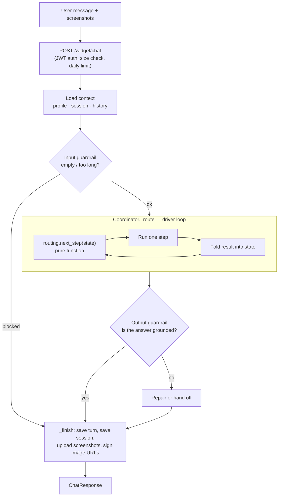
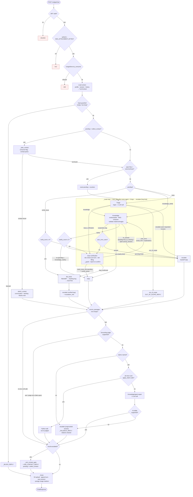
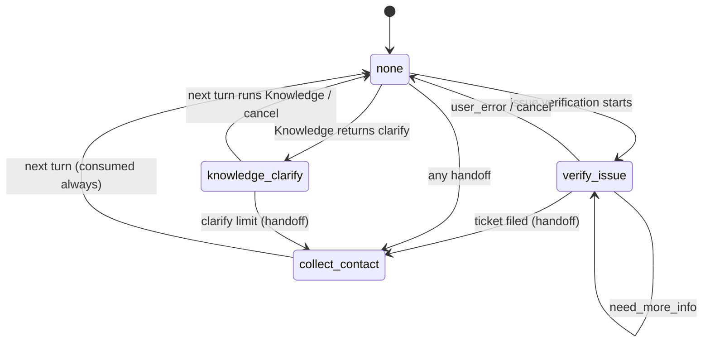

# Agent Customer Support

A Vietnamese-language customer support agent for CenLab cloud software, built as a multi-agent pipeline behind a FastAPI server, with a Next.js chat widget/admin UI.

## Architecture

The system is a set of small agents. One **Coordinator** controls them. The agents
never call each other — they only return a result to the Coordinator, and the
Coordinator decides what runs next.

### How the agents communicate

All agents share one simple contract (`agents/base.py`):

```python
class Agent(Protocol):
    name: str
    async def run(self, ctx: TurnContext) -> AgentResult: ...
```

- **Input: `TurnContext`** (`agents/context.py`) — everything one turn needs: the
  customer profile, the session state, the conversation history, the user message,
  attachments, and handles to shared services (RAG client, backlog, escalator…).
  The Coordinator builds it once per turn and passes the same object to every agent.
- **Output: `AgentResult`** (`models.py`) — the reply text plus small, typed signals
  for the Coordinator: `routed_to` (from Triage), `knowledge_status` (from
  Knowledge), `verify_outcome` (from Issue verification), `evidence`, `citations`,
  `escalated`.
- **Prose between agents:** when one agent must pass an explanation (not a decision)
  to the next, the Coordinator puts it in `ctx.route_hint`. Today only one path uses
  it: Issue verification says "this is a user error, here is why", and Knowledge
  uses that text when it writes the answer.

Because agents only read `TurnContext` and only return `AgentResult`, each agent can
be tested alone, and no agent writes routing state into the session.

### Data flow: from user input to reply



Step by step:

1. **API layer** (`channels/widget.py`) checks the JWT, takes the customer id from
   the token (never from the request body), checks upload size (413) and the daily
   question limit (429).
2. **Load context.** The Coordinator reads the customer profile (DynamoDB), the
   session (Redis) and the conversation history (DynamoDB), and builds `TurnContext`.
3. **Input guardrail.** Cheap checks with no LLM call: empty or oversized input.
4. **Route.** A loop that runs agents one by one until a final step (see below).
5. **Output guardrail.** If the reply cites a document, an LLM judge checks every
   claim against the retrieved passages. A bad reply is repaired or handed off.
6. **Finish.** Save the turn and the session, store screenshots in S3, and turn image
   markers into short-lived signed URLs for the response only.

### How the Coordinator controls the branches

The routing decision and the routing actions are in two different files:

- **`agents/routing.py` — the decision.** `next_step(RouteState) -> (step, reason)` is
  a pure function. It reads a small frozen snapshot (`pending`, the triage target,
  the last Knowledge status, the last verification outcome, and the loop counters)
  and returns the next step. It does no I/O and no LLM call, so every rule is one
  plain unit test.
- **`Coordinator._route` — the driver.** It runs the step, updates the session, folds
  the result back into the snapshot, and asks `next_step` again. It stops when the
  step is terminal: `reply`, `escalate`, `out_of_scope`, `file_ticket` or
  `attach_contact`.

Rules are checked in this order (first match wins):

| Priority | Condition | Next step |
|---|---|---|
| 1. Safety | 6 hops in one turn | `escalate` ("hop limit") |
| 2. Contact | the turn after a handoff contains a phone or email | `attach_contact` |
| 3. Open flow | `pending = verify_issue` | `issue_verification` (or `file_ticket` after 4 turns) |
| | `pending = knowledge_clarify` | `knowledge` |
| 4. Verification result | `bug_confirmed` | `file_ticket` |
| | `user_error` | `knowledge` (explain how the feature works) |
| | `need_more_info` | `reply` (ask the user) |
| 5. Knowledge result | `suspected_bug` | `issue_verification` (or `escalate` if this already bounced once) |
| | `clarify` | `reply` (or `escalate` after 2 questions) |
| | `no_answer` | `escalate` |
| | `answer` | `reply` |
| 6. Triage result | `knowledge` / `issue_verification` / `escalate` / `out_of_scope` | that step |
| 7. Nothing yet | new turn | `triage` |

Each rule returns a **reason** string. It is written on the Langfuse span, and for a
handoff it is also the reason the CS team reads. The root `turn` span stores the
whole path (for example `["triage", "knowledge", "reply"]`).

A user can leave an open flow with a cancel phrase ("thôi bỏ qua", "câu hỏi khác").
This is a regex (`routing.wants_cancel`), not an LLM call.

Example paths:

- Simple question: `triage → knowledge → reply`
- Bug report: `triage → issue_verification → reply` … (next turns) … `issue_verification → file_ticket`
- Not a bug after all: `knowledge → issue_verification → knowledge → reply`

### What each agent is responsible for

| Agent | File | Job | LLM calls |
|---|---|---|---|
| **Coordinator** | `agents/coordinator.py` | Owns the turn: loads context, drives routing, owns all session state, runs side effects (ticket, contact), saves everything. | none itself |
| **Triage** | `agents/triage.py` | Classifies the message: `knowledge`, `issue_verification`, `escalate` or `out_of_scope`. It is the only scope gate. Route only — it never writes a reply. | 1 structured call |
| **Knowledge** | `agents/knowledge.py` | Answers from the docs: rewrites the question into a standalone query, searches Qdrant, writes the answer with citations. Reports `answer`, `clarify`, `no_answer` or `suspected_bug`. | 1–2 (contextualize + compose), +1 on repair |
| **Issue verification** | `agents/issue_verification.py` | When a bug is suspected: first checks the docs (maybe it is normal behavior), then collects the facts a ticket needs (module, version, steps, expected, actual, time). Reports `need_more_info`, `user_error` or `bug_confirmed`. | 1 per turn (+1 doc check, +1 report) |
| **Escalation** | `agents/escalation.py` | Hands the user to a human. For three reasons (`verified bug`, `knowledge unresolved`, `clarify limit`) it also notifies CS by Zalo and email. | none |
| **Guardrail** | `agents/guardrail.py` | Input: cheap length checks. Output: grounding judge that lists unsupported claims with a severity. | 1 on cited answers only |

Two steps are not agents but Coordinator methods: **file ticket** (MantisBT ticket →
backlog row → Zalo/email) and **attach contact** (writes the user's phone/email onto
the conversation, the backlog row and the MantisBT ticket).

## Workflows by use case

This section follows the data through every path a turn can take. Each path lists
the route (the `path` stored on the root `turn` span), what each step reads and
returns, and what is written or sent.

### The frame every turn shares

Every path below runs inside the same frame (`Coordinator.handle_turn`):

```
POST /widget/chat
  │  JWT → customer_id · 413 size check · 429 daily limit (UsageStore.try_consume)
  ▼
Load context ── CustomerRegistry.get ── SessionStore.get ── ConversationStore.load
  │  builds TurnContext {customer, session, conversation, message, attachments,
  │                      transcript, rag, doc_images, backlog, qa_store, escalator}
  ▼
Input guardrail (no LLM) ── blocked? → _BLOCK_REPLY → _finish
  ▼
_route
  │  1. _take_contact   pending == collect_contact? consume it, parse phone/email
  │  2. _maybe_cancel   pending is verify_issue/knowledge_clarify + cancel regex? reset
  │  3. loop: next_step(state) → run step → state.after(result, session)
  ▼
Output guardrail ── only if result.source_passages is non-empty (1 LLM call)
  │  fail → _repair_or_escalate
  ▼
result.escalated? → _arm_contact_gate (append ASK_CONTACT_REPLY,
  │                  pending = collect_contact, pending_context = refs)
  ▼
_finish ── upload screenshots to S3 · ConversationStore.append (reply with markers)
        ── SessionStore.save · presign image markers for the response only
  ▼
ChatResponse {reply, citations, attachments, escalated}
```

The session object is changed in place by the driver and saved once in `_finish`.
Agents never write the session. They only return an `AgentResult`.

### Overview of all paths



Notes on the chart:

- Every `escalate` box runs `EscalationAgent`. Only `verified bug`, `knowledge
  unresolved` and `clarify limit` send Zalo + email (see the table at the end of this
  section). The other reasons only return the handoff reply.
- In practice `source_passages` is non-empty only for a Knowledge `answer` that cited
  a real passage. Every other result skips the judge without an LLM call.
- The loop counts hops. If a turn reaches 6 hops, the next step is `escalate` ("hop
  limit"), wherever it is.

### Session state across turns

`session.pending` is the only thing that carries a flow from one turn to the next:



### 1. A question answered from the docs

**Path:** `triage → knowledge → reply`

| Step | Reads | Does | Returns / writes |
|---|---|---|---|
| Triage | `ctx.as_messages()` | Regex for "gặp nhân viên…" first; else 1 structured call (`TriageDecision`) | `routed_to="knowledge"` (also the default when the call fails) |
| Knowledge · contextualize | transcript, attachments | Skipped on a first turn with no image. Else 1 call rewrites the message into a standalone query | `query` |
| Knowledge · search guides | `query`, `session.selected_applications` | Embed once → Qdrant search with hard application filter (`search_with_fallback`) | passages + metas |
| Knowledge · images | passages, metas | `DocImageStore.catalog` lists real files in S3; `media/…` refs become `[[img:…]]` markers | rewritten passages + **image catalog** |
| Knowledge · search Q&A | `query` | Q&A collection, top 1, threshold 0.85 (errors are caught) | Q&A passages |
| Knowledge · catalog | metas, Q&A metas | `citations.catalog` lists the ids the model may cite | **citation catalog** |
| Knowledge · compose | passages, Q&A, process block, transcript | 1 structured call (`ComposedAnswer`) | `answer`, `status`, `application`, `cited` |
| Knowledge · validate | composed answer + both catalogs | `_resolve_status`; `doc_images.select` drops unknown markers; `citations.select` drops unknown ids and keeps only guides | `AgentResult(knowledge_status="answer", citations, source_passages)` |
| Router | `knowledge_status="answer"` | — | `reply` |
| Output guardrail | reply + `source_passages` | Grounding judge (1 call), only when a real passage was cited | pass → reply unchanged |
| `_finish` | — | Save turn and session; presign images | `ChatResponse` |

**Wider retry.** If the selected applications return zero passages, Qdrant is
searched once more over `customer.enabled_applications`. If that hits, the compose
prompt gets a note naming the other application, so the reply tells the user where
the feature really is. The path does not change.

### 2. The question is unclear (clarify)

**Turn 1 path:** `triage → knowledge → reply`

- Knowledge returns `status="clarify"` (or `no_answer` while clarifying is still
  allowed — this becomes a fixed "please tell me which screen…" question).
- The driver sets `clarify_count += 1` and `pending = "knowledge_clarify"`.
- The reply is the question. No citations, and no output-guardrail call.

**Turn 2 path:** `knowledge → …` (Triage is skipped; `pending` sends the turn
straight to Knowledge, and the flag is cleared.)

- Knowledge runs again with the whole transcript, so the user's answer is in context.
- `answer` → `reply`. `suspected_bug` → path 5.
- `clarify` again → `clarify_count` becomes 2 → `escalate` ("clarify limit"). That
  question is **not** shown; the user gets the handoff reply instead. So in practice
  the user sees one clarifying question, and the second one becomes a handoff.
- `no_answer` → `escalate` ("knowledge unresolved"), see path 3.

### 3. The docs have no answer

**Path:** `… knowledge → escalate` (reason `knowledge unresolved`)

Reached when Knowledge gets a miss and may no longer clarify. Before returning,
Knowledge writes:

1. `RequestBacklog.add(type="how_to_missing")` — a row for CS to fill the gap.
2. `QAStore.add(QARecord(source="cannot_answer"))` — so CS can write the answer later
   and it becomes searchable (the learning loop).

Then `EscalationAgent` notifies CS (Zalo + email, the customer's `manager_email` in
CC) and returns the handoff reply. The contact gate is armed (path 10).

### 4. The answer is not supported by its sources

**Path:** `triage → knowledge → reply`, then the output guardrail fails.

`_repair_or_escalate`, cheapest first:

| Rung | When | Data flow | Re-judged? |
|---|---|---|---|
| Python edit | every claim is `minor` and `apply_claims` can edit each span safely | reply + claims → edited reply | no |
| LLM repair | a `major` claim, or Python refused | `KnowledgeAgent.repair(reply, claims, source_passages)` — new image markers are dropped | yes, once |
| Escalate | no named claim, or the repair still fails | `escalation.run(reason="ungrounded answer")`; reply → `_FALLBACK_REPLY`; citations cleared | — |

"ungrounded answer" does **not** page CS. The contact gate is still armed.

### 5. A bug suspected by Knowledge

**Path (turn 1):** `triage → knowledge → issue_verification → reply` (or `→ knowledge → reply`, path 7)

1. Knowledge's compose returns `status="suspected_bug"`. Knowledge returns
   `evidence = {application, summary: user message, query: contextualized query}`.
2. Router → `issue_verification` ("suspected bug").
3. `_step_issue_verification` opens the flow:
   - `pending = "verify_issue"`, `verify_turns = 0`
   - `pending_context = VerifyContext{application, summary, query, since_turn}`
     (`since_turn` = index of this turn, so the ticket only takes screenshots from now on)
   - `ctx.evidence_images` = the newest 2 screenshots from the whole conversation, read
     back from S3.
4. `IssueVerificationAgent.run`:
   - **Doc check** (first turn only): search the guides again with `query`, 1 call
     (`DocCheck`). `works_as_documented` with a real cited source → `user_error`
     (path 7). Else `doc_expected` is saved and slot filling continues.
   - **Slot filling**: 1 call (`VerificationDecision`) → `BugSlots.merge` into what
     the session held → `_guard` (a slot is asked at most once; an unread answer to
     last turn's question is filed as written).
   - Returns `verify_outcome` + the whole merged `VerifyContext` as `evidence`.
5. The driver: `verify_turns += 1`, `pending_context = evidence`.
6. `need_more_info` → `reply` (the question for at most two missing slots).

### 6. A bug reported directly by the user

**Path (turn 1):** `triage → issue_verification → reply`

Same as path 5, but Triage routes there itself ("reported malfunction"). There is no
Knowledge evidence, so `summary` is the user's message, `query` is empty (the doc
check searches with the user's words), and `application` is set only when exactly
one application is selected.

**Next turns:** `issue_verification → reply` while `need_more_info`. Triage is
skipped because `pending = "verify_issue"`.

**Last turn:** `issue_verification → file_ticket` when `bug_confirmed`:

1. In the agent, before returning: 1 more call (`BugReport`: title, summary, steps).
   A failed parse uses `fallback_report`. Stored in `VerifyContext.report`.
2. `_step_file_ticket`, in this order:
   1. `_with_slots` folds the slots (and the still-empty ones) into the ticket body.
   2. `_evidence_files`: screenshots since `since_turn` (S3 + current turn), capped.
   3. `MantisClient.create_issue` — title `[BUG][<customer>] <title>`, transcript in
      additional info, assigned to `mantis_handler_name` (retried once without a
      handler on a 4xx). Never raises.
   4. `RequestBacklog.add(type="bug", mantis_issue_id=…)`.
   5. Session flow reset: `pending`, `pending_context`, `verify_turns`.
   6. `EscalationAgent.run(reason="verified bug", note=ticket URL or "file by hand")`
      → Zalo + email.
   7. `escalation_refs = {backlog_id, mantis_issue_id, mantis_issue_url}` for path 10.

### 7. Not a bug after all (user error)

**Path:** `… issue_verification → knowledge → reply`

- The verifier returns `user_error` (from the doc check, or later from slot filling
  using "THEO TÀI LIỆU" = `doc_expected`). Its reply is the explanation.
- The driver closes the flow (`pending = None`, `pending_context = None`,
  `verify_turns = 0`) and sets `user_error_seen = True`.
- Router → `knowledge` ("not a bug, explain usage"). `ctx.route_hint` = the
  verifier's explanation, so the composed answer explains the correct usage.
- No ticket, no backlog row, nobody paged.

**Ping-pong guard:** if Knowledge reports `suspected_bug` again in this conversation,
`user_error_seen` is already set, so the router escalates ("bug loop", no paging)
instead of verifying again.

### 8. Evidence collection hits the cap

**Path:** `file_ticket` (reason `verify turn cap`)

At the start of a turn with `pending = "verify_issue"` and `verify_turns ≥ 4`, the
router goes straight to `file_ticket` — the verifier is **not** called again. The
ticket uses `VerifyContext.report` if one exists, else `fallback_report` from the
opening message. `_with_slots` lists the empty slots, so CS can see the ticket is
incomplete. The rest is the same as path 6.

### 9. Short paths that end at once

| Use case | Path | LLM calls | Writes / notifications |
|---|---|---|---|
| Input blocked (empty / too long) | — (no routing) | 0 | turn + session saved |
| Off-topic question | `triage → out_of_scope` | 1 (triage) | none; `OUT_OF_SCOPE_REPLY` |
| User asks for a human | `triage → escalate` ("user requested human") | 0 (regex) or 1 | no paging; contact gate armed |
| User cancels an open flow ("thôi bỏ qua") | `triage → …` as a new turn | as for the new turn | `pending`, `pending_context`, both counters reset |
| Hop limit (a cycle the rules missed) | `… → escalate` ("hop limit") | as run so far | no paging; contact gate armed |

### 10. Contact follow-up after a handoff

**Turn N (handoff):** any result with `escalated=True` →
`_arm_contact_gate` appends `ASK_CONTACT_REPLY` and sets
`pending = "collect_contact"`, `pending_context = {reason, backlog_id?, mantis_issue_id?, mantis_issue_url?}`.
Only the verified-bug path fills the ticket refs.

**Turn N+1:** `_take_contact` always consumes the flag (the user is asked once).
`contact.parse` (regex) looks for a VN phone number or an email.

- **Found** → path `attach_contact`. Each write is independent and best-effort:
  1. `ConversationStore.set_contact`
  2. `RequestBacklog.set_contact` (if `backlog_id`)
  3. `MantisClient.add_note` (if `mantis_issue_id`)

  Reply: `CONTACT_THANKS_REPLY`. (The CS re-notification is commented out today.)
- **Not found** → the message is routed normally from `triage`, because it is usually
  a new question.

### Who is notified, per handoff reason

| Reason | From | Zalo + email | Backlog row | MantisBT |
|---|---|---|---|---|
| `verified bug` | path 6 / 8 | yes | `bug` | yes |
| `knowledge unresolved` | path 3 | yes | `how_to_missing` (+ Q&A `cannot_answer`) | no |
| `clarify limit` | path 2 | yes | no | no |
| `user requested human` | path 9 | no | no | no |
| `bug loop` | path 7 | no | no | no |
| `hop limit` | path 9 | no | no | no |
| `ungrounded answer` | path 4 | no | no | no |

Every row ends with the same handoff reply plus the contact ask.

## Memory and storage

The agents themselves are stateless. All memory is in stores, read at the start of a
turn and written at the end.

### Short-term memory (one conversation)

| What | Where | Lifetime | Used for |
|---|---|---|---|
| `SessionState` | Redis (`SessionStore`) | 1 hour TTL (`SESSION_TTL_SECONDS`), renewed each turn | Routing state: `pending` (which flow is open), `pending_context` (bug slots collected so far, doc-check result, ticket refs), counters (`clarify_count`, `verify_turns`, `user_error_seen`), `selected_applications` |
| `TurnContext` | in memory | one turn | Everything the agents read in this turn |
| Current screenshots | in memory (base64) | one turn | Sent to the LLM; then stored in S3 and only the key is kept |

The session is small and fast on purpose. If it expires, the user simply starts a new
flow; nothing important is lost because the full history is in DynamoDB.

### Long-term memory

| Store | Backend | Used for |
|---|---|---|
| `ConversationStore` | DynamoDB | Full message history. Agents re-read it every turn as the transcript. |
| `AttachmentStore` | S3 | Screenshot bytes. DynamoDB keeps only the S3 key (item size limit is 400 KB). |
| `CustomerRegistry` | DynamoDB | Customer profile: enabled applications, login, role, daily limit, ticket handler, manager email. |
| `RequestBacklog` | DynamoDB | One row per handoff (bug, missing answer…), with the MantisBT id and contact. |
| `UsageStore` | DynamoDB | Daily question counter per customer (key includes the date, so it resets by itself). |
| `FeedbackStore` | DynamoDB | Like/dislike per assistant message. |
| Q&A collection | Qdrant | Answers approved by CS from real conversations — the "learning" memory (see RAG). |
| Product docs | Qdrant | The user guides (knowledge base). |
| `FlowStore` | DynamoDB | Flow definitions (parked, not used in the live pipeline). |

## How RAG works

RAG (Retrieval-Augmented Generation) means: first find the right document passages,
then ask the LLM to answer **only from those passages**.

1. **Contextualize.** If there is earlier history or a screenshot, an LLM call
   rewrites the message into a standalone query ("xoá nó thì sao?" → "cách xoá mẫu
   xét nghiệm"). The first turn with no image skips this call.
2. **Embed.** The query is turned into a vector with Google `gemini-embedding-001`
   (`rag/embeddings.py`). It is embedded once, even when a retry happens.
3. **Search with a hard scope.** `rag_client.py` searches Qdrant with a server-side
   filter on `metadata.application`, so a customer only sees docs of the modules they
   selected. Documents with no application tag are global and always visible.
   Results under `score_threshold` (0.6) are dropped; top 8 are kept, and for a
   multi-module search each guide is capped so one guide cannot fill all slots.
4. **Search the Q&A store.** After the guides, the CS-approved Q&A
   collection is searched (top 1, threshold 0.85). A strong match leads the answer.
5. **Compose.** One structured LLM call (`ComposedAnswer`) gets the passages
   (numbered, with their section headings), the Q&A record, and an always-on
   "general process" block. It returns `answer`, `status`, `application` and
   `cited` (which passages and sections it used).
6. **Validate in code.** Citations and image markers are kept only if they exist in
   this turn's catalog — an invented passage id or image name is dropped.
7. **Check grounding.** The output guardrail judges the answer against all retrieved
   passages and repairs or hands off a bad answer (see failures below).

### Limitations

- **Only as good as the docs.** If a feature is not in the user guides or the Q&A
  store, the bot cannot answer it. It will hand off rather than guess.
- **Chunk boundaries.** A step list cut across two chunks may arrive half; a chunk can
  start in the middle of a table with no heading.
- **Fixed thresholds.** `score_threshold=0.6` and `top_k=8` are global. A good passage
  that scores 0.59 is lost; a weak passage at 0.61 is shown to the model.
- **Vietnamese wording.** Users often use words that differ from the guide's terms,
  or no accents. The contextualize step helps, but there is no keyword (BM25) search
  and no re-ranker — retrieval is vector-only.
- **Wrong module selected.** The scope filter is hard, so a wrong selection returns
  nothing. A wider retry fixes most cases (below), but only inside the modules the
  customer bought.
- **Cost and latency.** A normal answer is 2–4 model calls (triage, contextualize,
  compose, judge). The whole history is re-sent every turn, with no window or
  summary, so long conversations get slower and more expensive.
- **Stale data.** Document images are cached for 10 minutes; a re-ingested guide may
  show old images for a short time.

### What happens when retrieval fails

| Case | What the system does |
|---|---|
| **Zero passages in the selected scope** | Retry once, wider, over all modules the customer has enabled (never an unscoped search). If the answer comes from another module, the reply tells the user which module the feature is in. |
| **Passages found, but they do not answer** | The model still composes (the process block can answer process questions). If it cannot answer, it returns `clarify` and asks **one** question (with an invite to send a screenshot). After 2 questions, or with `no_answer`, the turn escalates to CS and a backlog row is logged. |
| **Q&A collection missing or Qdrant error on Q&A** | Caught; the answer uses the guides only. |
| **Answer cites a passage that does not support it** | Output guardrail: Python edit for minor claims → LLM repair → fallback reply + handoff. |
| **Answer cites an id that was not offered** | The citation is dropped in code. |

## Handling failures in the agentic workflow

The main rule: **the user must never reach a dead end, and a failure in one side
effect must not cost the reply.** These are the patterns used:

1. **Bounded loops, every limit ends in a handoff.** `MAX_HOPS=6` per turn,
   `MAX_CLARIFY=2` questions, `MAX_VERIFY_TURNS=4` evidence turns, and
   `user_error_seen` to stop a Knowledge ↔ Verification ping-pong. Hitting a limit
   escalates (or files the ticket with what was collected) instead of waiting forever.
2. **Structured output with safe defaults.** LLM calls return Pydantic schemas. When
   a parse fails, the default is the safe direction: Triage falls back to
   `knowledge`; a failed verification decision becomes `need_more_info` (a parse
   error can never file a ticket); a failed bug report uses `fallback_report` so the
   ticket is still filed.
3. **Python checks the model, not the other way round.** Citations and image markers
   are validated against a catalog; bug slots are merged in code and a slot is asked
   at most once (`_guard`); a doc-check "user error" verdict needs a real cited
   source, or it is ignored.
4. **A repair ladder for bad answers.** Cheapest first: a safe Python edit of the
   named claim → one LLM repair call (re-judged) → a fixed fallback reply and a
   handoff. The judge itself fails **open** — if it errors, the reply goes through.
5. **Graceful degradation for side effects.** After the reply is paid for, outages
   cost only their own part: S3 upload, image signing, MantisBT (`create_issue`
   never raises; the backlog row is still written and CS is told to file by hand),
   email (`CSMailer` never raises), contact updates (each step independent). A
   MantisBT handler that does not exist is retried once without it.
6. **Ordered writes.** Ticket → backlog → notification, so the backlog row carries the
   ticket id in one write and there is no half-updated record.
7. **Cheap gates before expensive steps.** Size limit, daily limit and input checks
   run before any LLM call; cancel detection is a regex; out-of-scope questions stop
   at Triage before RAG.
8. **Observability.** Every step has a Langfuse span with its reason, and the root
   span has the full path, so a bad route can be read from one trace.

**Known gaps:**

- `Escalator.escalate` still raises on a Zalo HTTP error, and `EscalationAgent` does
  not catch it, so a Zalo outage can fail the whole turn — and the CS email (sent
  after Zalo) is skipped too.
- There is no retry with backoff on LLM or Qdrant calls; a provider error on the main
  guide search or on compose fails the turn.
- The CS re-notification after a user leaves contact details
  (`Escalator.contact_update`) is currently commented out in `_attach_contact`.

## Implementation notes

### LLM layer

`llm/__init__.py` exports `complete_with_tools` and `complete_text` — the only LLM call sites. Model routing is automatic: model names containing `"claude"` use the Anthropic provider; everything else uses OpenAI. Per-agent model overrides live in `Settings` (`config.py`).

### Flows (parked — data layer only)

**There is no `FlowAgent`** — it was removed with `SessionState.active_flow_id`, so no flow
runs in the live pipeline. The data layer is kept: `models.py` defines `Flow → FlowStep →
FlowTransition → FlowOutcome`, `FlowEngine` (`flows/engine.py`) is a pure stateless
resolver, and flow JSON is seeded from `seeds/flows/` via `scripts/import_flows.py`.

### Observability

All tracing goes through `observability/tracing.py` (the only file that imports `langfuse`). It's a no-op when `LANGFUSE_PUBLIC_KEY` is unset. Spans follow the hierarchy: `turn` (chain) → `agent.<name>` (agent) → `llm.<agent>[.<step>]` (generation) / `tool.<name>` (tool) / `rag.search` (retriever). The parenthesised names are Langfuse **observation types**, which the UI filters and renders separately. A generation is named after the agent that made it and carries `metadata.agent` (plus `metadata.step` for a second call inside one agent, e.g. `llm.knowledge.contextualize`) — that is the handle for pointing a Langfuse evaluator at one agent's calls. The agent name reaches the LLM facade through a ContextVar set by `tracing.agent_span`, so no agent signature carries it.

## Getting started

Requires Python 3.13, [Poetry](https://python-poetry.org/), Docker (for local infra), and Node.js (for the UI).

```bash
# Install backend dependencies
poetry install

# Copy env vars and fill in API keys
cp .env-example .env

# Start dev infra: DynamoDB Local (port 8000) + Redis (port 6379)
make infra-up

# Run the API server (port 8800, hot-reload)
make run
```

In a separate terminal, run the UI:

```bash
cd ui
npm install
npm run dev
```

## Testing & linting

```bash
# Run all tests
make test

# Run a single test file or test
poetry run pytest tests/agents/test_triage.py -v
poetry run pytest tests/agents/test_triage.py::test_some_case -v

# Lint (ruff format + check + mypy)
make lint
```

Tests use DynamoDB Local + `fakeredis` — no real AWS credentials needed. `conftest.py` stubs all required env vars.

## Key environment variables

See `.env-example` for the full list. The important runtime ones:

- `ENVIRONMENT` — `dev` (default) or `prod`. Sets the enforced OpenAI reasoning profile: `dev` → `reasoning_effort=low`, 4000 max output tokens; `prod` → `high`, 8000. There is no per-key override — the Dockerfile ships no `ENV` defaults, so a prod deployment must inject `ENVIRONMENT=prod` in its task definition / compose override or it will silently run at `low` effort.
- `AGENT_MODEL` — default model (e.g. `gpt-5.4-mini`, `claude-sonnet-4-6`); override per agent with `TRIAGE_MODEL`, `KNOWLEDGE_MODEL`, `KNOWLEDGE_CONTEXTUALIZE_MODEL`, `VERIFICATION_MODEL`, `FLOW_MODEL`, `GUARDRAIL_MODEL`
- `QDRANT_ENDPOINT` / `QDRANT_API_KEY` — Qdrant instance backing RAG; `GOOGLE_API_KEY` + `EMBEDDING_MODEL` for query/document embeddings
- `LANGFUSE_*` — optional tracing; leave blank to disable
- `DYNAMODB_ENDPOINT_URL` — set to `http://localhost:8000` for local dev

## Project layout

```
agent_customer_support/
  agent/          # prompt assembly, tool definitions
  agents/         # coordinator + pipeline agents (triage, knowledge, issue_verification, ...)
  channels/       # FastAPI routers (widget, admin)
  flows/          # stateless flow-resolution engine (parked, no agent uses it)
  llm/            # provider-agnostic LLM facade (Anthropic/OpenAI)
  observability/  # Langfuse tracing
  rag/            # embeddings, QA indexing
  stores/         # Redis/DynamoDB-backed stores
  server.py       # FastAPI app entrypoint
scripts/          # eval, import, and smoke-test scripts
seeds/            # flow definitions seeded into FlowStore
ui/               # Next.js chat widget + admin UI
tests/            # pytest suite mirroring the package layout
```
